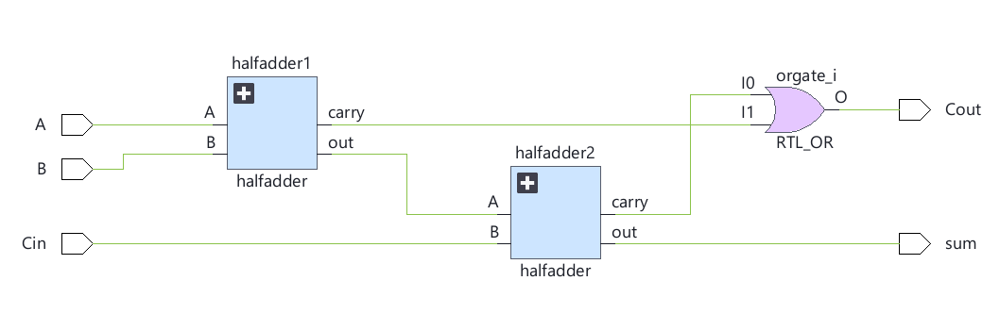
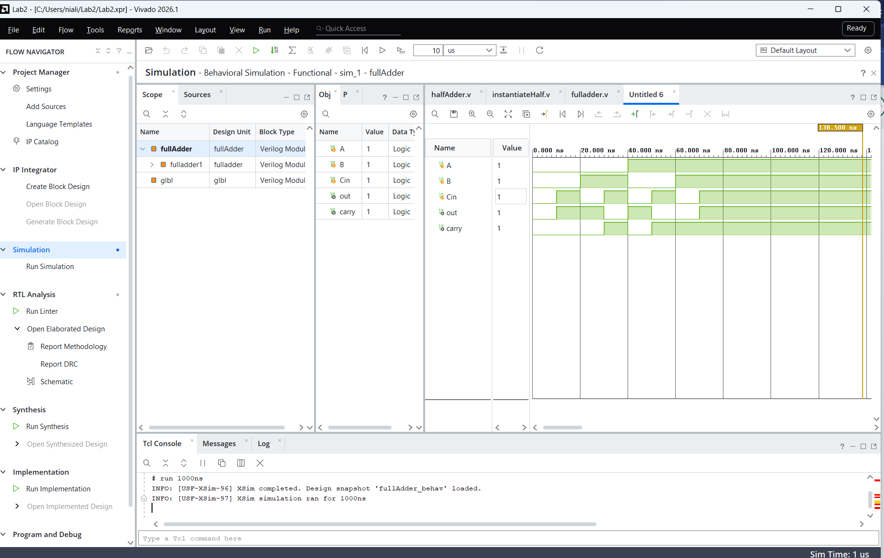
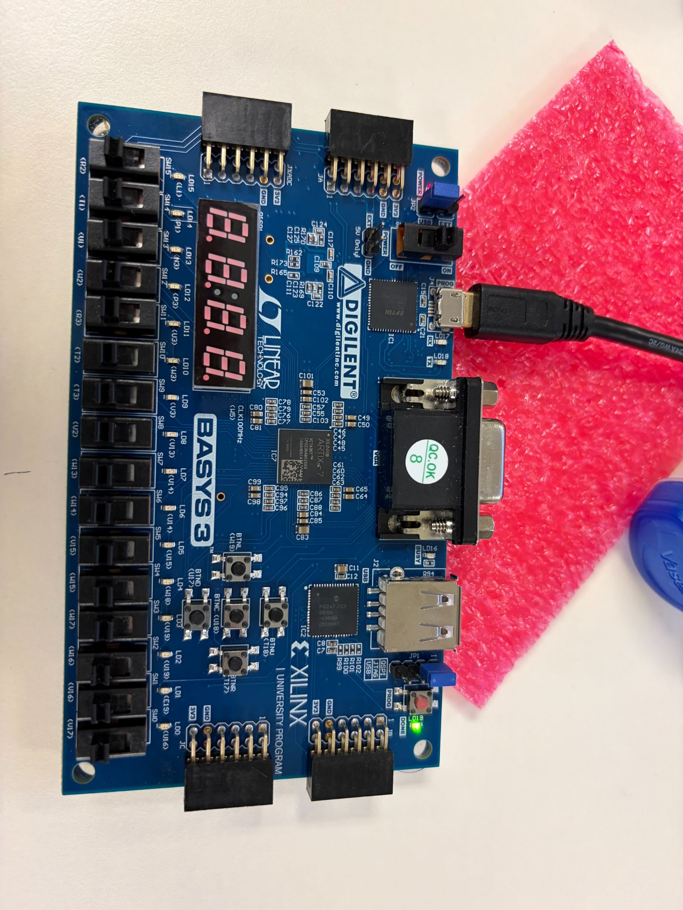
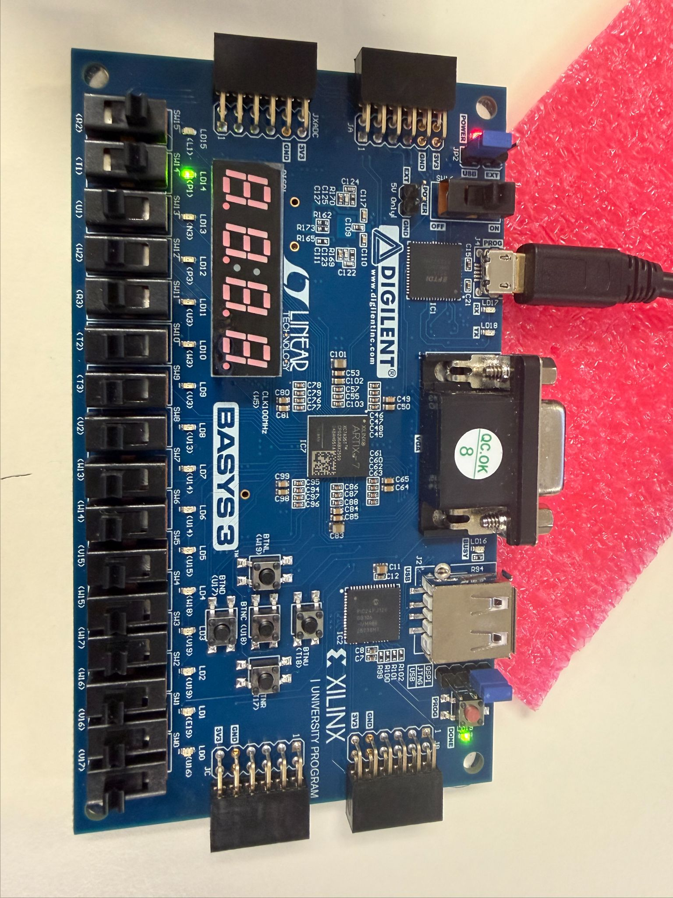
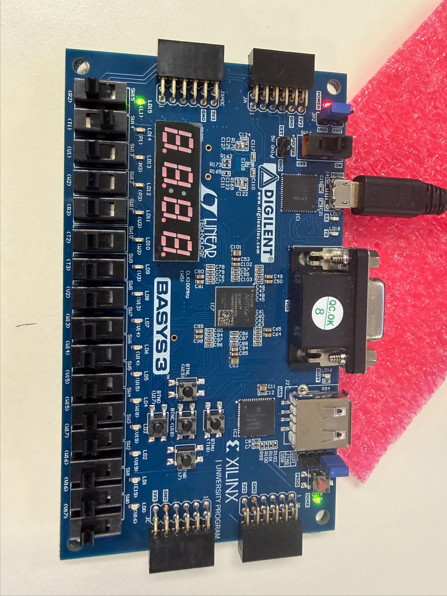
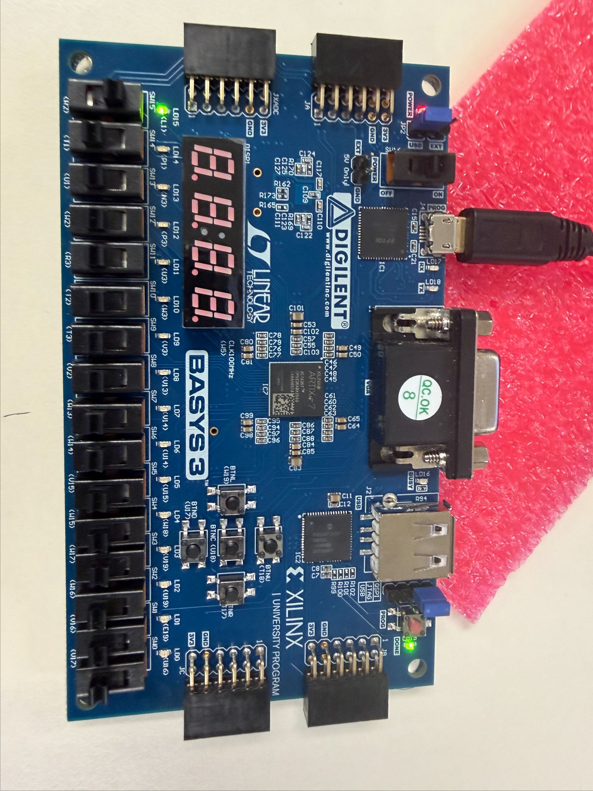

# Full-Bit-Adder

# 1-Bit Full Adder in Verilog on a Basys 3 FPGA

   

ECE 25 (Digital Design) · Lab 2

A structural Verilog 1-bit full adder built from two half adders and an OR gate. It was checked in Vivado behavioral simulation against all 8 input combinations, then programmed onto a Basys 3 board and demonstrated with switches and LEDs.


## TL;DR

| | |
|---|---|
| **Goal** | Add three 1-bit inputs (`A`, `B`, `Cin`) to produce a `sum` bit and a carry-out bit (`Cout`) |
| **Logic** | `sum = A ⊕ B ⊕ Cin`, `Cout = A·B + Cin·(A ⊕ B)` |
| **Verification** | Testbench steps through all 8 input combinations, 10 ns apart |
| **Hardware** | Basys 3 (Artix-7 `xc7a35tcpg236-1`); inputs on switches, outputs on LD15 / LD14 |
| **Key finding** | Simulation and board behavior both match the full-adder truth table |


## Design

### Gate-level structure

The first half adder adds `A` and `B`. The second half adder adds that partial sum to `Cin`, and its `out` becomes the final `sum`. A carry from either half adder sets `Cout`, so the two carries are ORed together.

<p align="center">
  
</p>

### Truth table

| A | B | Cin | sum | Cout |
|:-:|:-:|:---:|:---:|:----:|
| 0 | 0 | 0 | 0 | 0 |
| 0 | 0 | 1 | 1 | 0 |
| 0 | 1 | 0 | 1 | 0 |
| 0 | 1 | 1 | 0 | 1 |
| 1 | 0 | 0 | 1 | 0 |
| 1 | 0 | 1 | 0 | 1 |
| 1 | 1 | 0 | 0 | 1 |
| 1 | 1 | 1 | 1 | 1 |

`sum` is 1 when an odd number of inputs are 1, and `Cout` is 1 when at least two inputs are 1.


## Verification

### Testbench: [`sim/instantiate`](sim/instantiate)

The testbench instantiates `fulladder` and applies all 8 input combinations in binary counting order (`000` to `111`), changing every 10 ns.

```verilog
`timescale 1ns/1ps
module fullAddersim();

reg A, B, Cin;
wire out, carry;
fulladder fulladder1(A, B, Cin, out, carry);

    initial begin
    A = 0; B = 0; Cin = 0;
    #10 A = 0; B = 0; Cin = 1;
    #10 A = 0; B = 1; Cin = 0;
    #10 A = 0; B = 1; Cin = 1;
    #10 A = 1; B = 0; Cin = 0;
    #10 A = 1; B = 0; Cin = 1;
    #10 A = 1; B = 1; Cin = 0;
    #10 A = 1; B = 1; Cin = 1;
    end

endmodule
```

### Simulation waveform

Each 10 ns slice of the waveform is one row of the truth table. `out` (sum) and `carry` (Cout) match the table in every slice.

<p align="center">
  
</p>

---

## Hardware Demo

After the TA approved the design, four board photos were taken, one for each combination of the two output LEDs:

1. LD15 and LD14 are OFF
2. LD15 is ON, LD14 is OFF
3. LD15 is OFF, LD14 is ON
4. LD15 and LD14 are ON

LD15 and LD14 show the adder's two outputs (`sum` and `Cout`). There is more than one way to reach some of these states because different input combinations give the same output:

| State | LD15 | LD14 | Input combinations (A B Cin) that produce it |
|:-:|:-:|:-:|---|
| 1 | OFF | OFF | `000` (only one way) |
| 2 | ON  | OFF | depends on LED mapping: `001`, `010`, `100` (one input high) **or** `011`, `101`, `110` (two inputs high) |
| 3 | OFF | ON  | the other group from state 2 |
| 4 | ON  | ON  | `111` (only one way) |

States 1 and 4 can each be reached only one way. States 2 and 3 can each be reached three ways: one 1 among the inputs gives `sum = 1, Cout = 0`, and two 1s give `sum = 0, Cout = 1`.

<p align="center">
  
  
</p>
<p align="center">
  <em>State 1: both off &nbsp;·&nbsp; State 2: LD15 on, LD14 off</em>
</p>
<p align="center">
  
  
</p>
<p align="center">
  <em>State 3: LD15 off, LD14 on &nbsp;·&nbsp; State 4: both on</em>
</p>

---

## How to Reproduce

**Requirements:** Xilinx Vivado (any recent version), Digilent Basys 3 board, micro-USB cable.

1. Create a new **RTL Project** that targets device **`xc7a35tcpg236-1`**.
2. Add `src/halfadder.v` and `src/fulladder.v` as **design sources**.
3. Add `sim/instantiate` as a **simulation source**.
4. Add a Basys 3 `.xdc` constraints file that maps the three inputs to switches and `sum` / `Cout` to LD15 and LD14.
5. **Run Simulation → Run Behavioral Simulation.** Confirm the waveform matches the truth table.
6. **Run Synthesis → Run Implementation → Generate Bitstream.**
7. Plug in the board, then **Open Hardware Manager → Open Target → Auto Connect → Program Device**.
8. Flip the input switches and confirm the LEDs follow the truth table.

---

## Concepts Covered

- Half adder vs. full adder
- Hierarchical, structural Verilog (module instantiation)
- Writing a testbench and reading a simulation waveform
- Taking a design from Vivado to FPGA hardware

---

## Repository Structure

```
.
├── src/            # Design sources (halfadder.v, fulladder.v)
├── sim/            # Testbench (instantiate)
├── media/          # Schematic, simulation waveform, board photos
├── LICENSE
└── README.md
```

## Tools

- Xilinx Vivado (RTL analysis, behavioral simulation, synthesis, Hardware Manager)
- Digilent Basys 3 (Artix-7 `xc7a35tcpg236-1`)
- Verilog HDL
